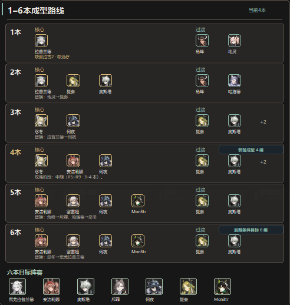
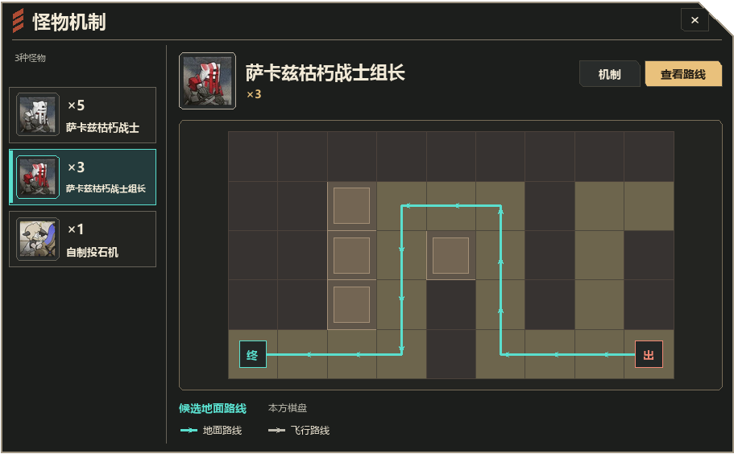

# 卫戍助手

## 更新说明

**0.12.0-preview.11** · 2026 年 11 月 26 日 · 上一版 0.12.0-preview.7

- **联机商店提示。** 绝境模拟从四个卡位开到六个卡位，拿牌提示都会贴着各自的牌显示。买牌或刷新后，推荐跟着新商店更新。
- **流派和站位。** 同一局手动选过的流派可以跨回合保留。站位建议放大了字号，位置和朝向分行显示，全屏时鼠标移到助手按钮上也能看见指针。
- **Boss 个人输出。** 每位玩家的占比按累计对 Boss 造成的伤害除以 Boss 总血量计算。游戏传来新记录后，顶部直接更新。结算沿用上一笔记录时会标出「上次读数」。

[点击直接下载 Windows x64 安装包](https://github.com/agtyin-code/arknights-weishu-assistant/releases/download/v0.12.0-preview.11/WeishuAssistant-0.12.0-preview.11-win-x64-setup.exe) · [完整更新说明](https://github.com/agtyin-code/arknights-weishu-assistant/releases/tag/v0.12.0-preview.11) · [历史版本](https://github.com/agtyin-code/arknights-weishu-assistant/releases)

## 这款助手能做什么？

这是给《明日方舟》PC 端卫戍协议做的内嵌式助手。进对局后，它就在游戏画面里。商店上方看拿牌提示，左边查流派和图鉴，按 `W` 看这波怪。查完收起来，继续打。

做这个是因为打到一半忘了装备怎么三连、下一本该找谁时，我也得切出去翻资料。刚入坑可以照一图流找过渡牌，玩熟了可以看看现在的阵容还有哪些路可走。习惯自己拿牌，也可以只开常用的图鉴、敌情和输出统计。

**纯粹用爱发电，下载和使用都免费。** 欢迎提建议、修 bug，也欢迎用源码做自己的免费工具。分享时请保留来源和协议，注明改动。原版、套壳版和基于本项目改出来的成品均禁止售卖。对在中国大陆境内违反协议并侵害作者权益的行为，作者保留依法追究和起诉的权利。[开发者协议](LICENSE.md)

## 安装启动和快捷键

1. 双击上面的安装包，安装后从桌面或开始菜单打开「卫戍助手」。
2. Windows 弹出授权提示时按提示操作。可以自己开明日方舟，也可以点等待页上的「方舟？卫戍！启动！」。
3. 进入卫戍对局。左上角的书是图鉴，左栏是「流派与拿牌」，游戏里按 `W` 看怪。

| 快捷键 | 用途 |
| --- | --- |
| `W` | 游戏内打开或收起敌情 |
| `Ctrl+Shift+H` | 隐藏或显示助手 |
| `Ctrl+Shift+Q` | 退出助手 |

从旧版升级时，先退出助手，再运行新版安装包。适用于 **Windows x64** 和《明日方舟》PC 端。

## 功能目录

| 对局里想看什么 | 跳到对应说明 |
| --- | --- |
| 查干员、盟约、装备或三连效果 | [卫戍内置图鉴](#卫戍内置图鉴) |
| 开局选策略，查本局规则和首领 | [开局策略推荐](#开局策略推荐) · [本局详情与首领](#本局详情与首领) |
| 选流派，找这一轮和下一本的牌 | [流派推荐](#流派推荐) · [1到6本运营一图流](#1到6本运营一图流) |
| 买牌、刷新、冻结或升本 | [商店拿牌提示](#商店拿牌提示) · [刷新冻结和升本](#刷新冻结和升本) |
| 看地图、站位和装备 | [地图站位建议](#地图站位建议) · [八人装备图](#八人装备图) |
| 查怪、看路线、选悬赏 | [怪物图鉴与敌情](#怪物图鉴与敌情) · [悬赏推荐指数](#悬赏推荐指数) |
| 查零漏率和输出占比 | [战前胜率和漏怪预测](#战前胜率和漏怪预测) · [Boss 输出和防守输出](#boss-输出和防守输出) |
| 收起平时用不到的东西 | [显示设置](#显示设置) |

## 卫戍内置图鉴

点左上角的书，准备阶段和战斗中都能翻。四个分类是盟约、干员、装备和策略。干员可以按 1 到 6 档筛选，点开卡片就能查普通与三连效果。想确定这局还有哪些盟约和干员可用，可以在对应分类切到「本局」。

## 开局策略推荐

开局第二页选策略时，助手会从这局的候选里，结合地图和可用盟约，给出输出、生存和经济方面的建议。策略效果就在头像旁边。想看队友怎么选，可以先点「折叠」。

## 本局详情与首领

从「流派与拿牌」进「本局详情」，可以查地图、策略、可用和禁用盟约。常规首领和隐秘首领分开显示，隐秘首领的候选和触发状态也各自标明。

## 流派推荐

「自动推荐」会结合场上、备战区、商店和本轮敌人选打法，来牌变化时也会给出转型建议。「手动选择」会沿你选定的打法继续推荐，可以按盟约和关键词找流派。想自己拿牌，选「我自己随心打」。进入战斗后还能看下一轮的拿牌计划。

## 1到6本运营一图流

左边看这本要找谁，右边展开 1 到 6 本的阵容。核心没来时先拿什么、哪一档该换人、哪些干员能互相替代，都在图上。有替代牌的档位会写「任选 1」，旁边能看手里已经有几名。「打法步骤」另写了升本时机、叠层和成型后的安排。

## 商店拿牌提示

卡牌上方会标「必拿」「过渡」或相关盟约。买完一张，助手会按剩下的钱重算。比如这轮容易掉血，钱又少，就先找买得起的过渡牌，或看看调整站位能不能顶住。点卡牌上方的提示，可以看牌的效果和用途。

## 刷新冻结和升本

| 商店入口 | 提示怎么看 |
| --- | --- |
| 刷新 | 扣掉刷新费后，刷出且买得起至少一张目标牌的机会。 |
| 冻结 | 眼前的目标买不起时，比较留住这张牌和下回合换店的价值，也会考虑升本后可能出现的高阶牌。 |
| 升本 | 显示费用，并按当前资金和阵容判断这轮升本是否合适。 |

牌池详情会列出已经观察到的持有数和参考容量。有售出回款、产钱装备或策略时，可以在「本局运营」里看这一轮怎么花。

## 地图站位建议

点「站位 / 装备」，左边是地图。**A 当前**显示现有站位，切到 **B 建议** 后点「生成建议」，可以看哪些干员该挪、朝哪边。图上能对照地面和飞行敌路。排站位会参考攻击范围、阻挡、对空和治疗。

## 八人装备图

在「地图站位与装备」右半边，每个干员头像下面就是装备格。图标会标出已装备、手里有、商店里有或缺失的装备，鼠标放上去看名字和效果。普通干员两格，森蚺策略下的暴躁铁皮（巨丑）普通四格，三连后六格。

## 怪物图鉴与敌情

按 `W` 打开游戏敌情，助手会跟着显示怪物详情。左边按头像选怪，右边查生命、攻击、防御、法抗，以及攻击方式、阻挡和特殊能力。点「查看路线」可以看它在本方棋盘上的候选走法。同一只怪有多条路线时可以切换查看。

## 悬赏推荐指数

三选或六选时，悬赏卡上方会显示 1～10 分。分数会参考当前阵容能打过的把握和悬赏奖励。点分数能查看对应的怪，评估还在计算时可以先查可能出现的敌人。

## 战前胜率和漏怪预测

普通回合看游戏顶部的「本轮零漏率」，它估的是这波一个怪也不漏的机会。联机时会按玩家分别显示。「若漏 2 个」指估计中一旦漏怪，最可能漏 2 个。准备阶段阵容和站位变化后会重算。

## Boss 输出和防守输出

| 什么时候看 | 百分比的分母 |
| --- | --- |
| Boss 战，顶部查看每位玩家打掉了多少血 | Boss 的总血量 |
| 普通防守，点击下沿展开或折叠干员头像和占比 | 本场全队的总伤害 |

## 显示设置

用左侧的滑杆图标打开显示设置。战前胜率、Boss 输出、防守输出、商店建议、流派与运营、站位建议都可以单独开关。平时只想查图鉴和敌情，可以切换到只看资料。设置会记在本机。

## 感谢

谢谢 [SquadPool] 和 [PRTS Wiki] 整理卫戍资料，也谢谢愿意开局帮忙试功能的人。卫戍助手是玩家制作的非官方工具。游戏名称、角色和美术归各自权利人，第三方资料和库沿用原有许可。

[SquadPool]: https://squad-pool.com/arknights-pacts
[PRTS Wiki]: https://prts.wiki/
