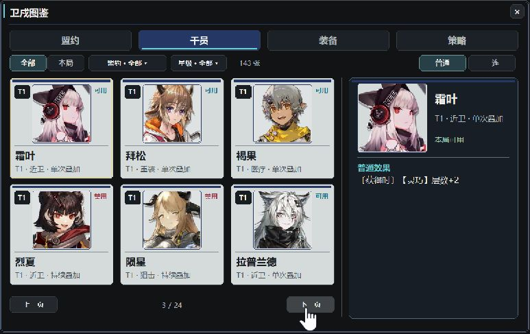
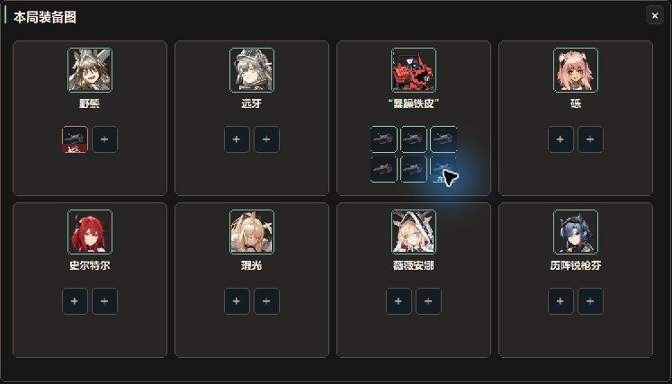
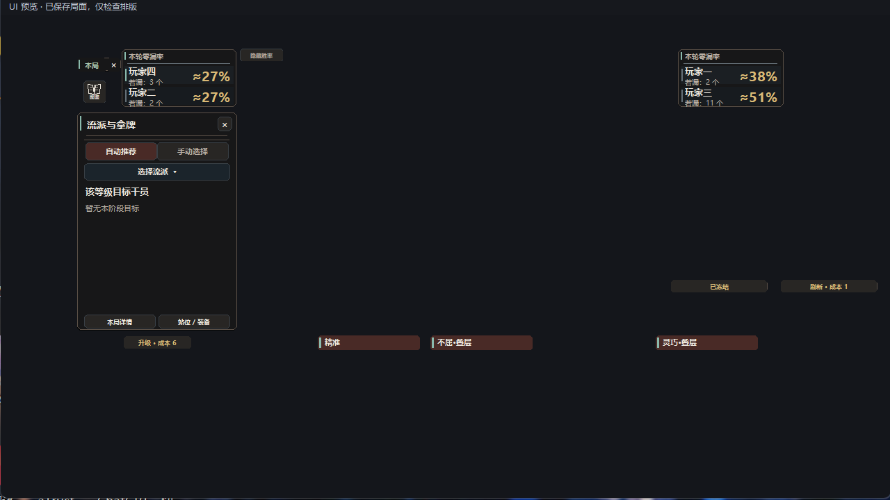
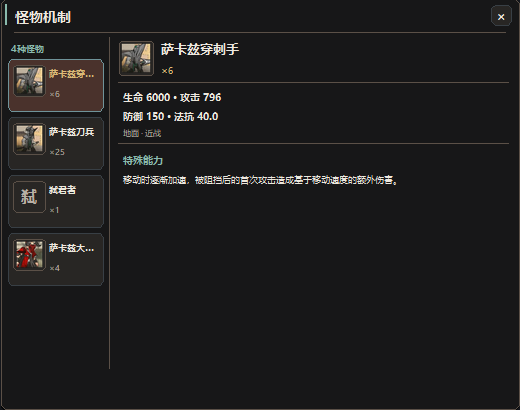
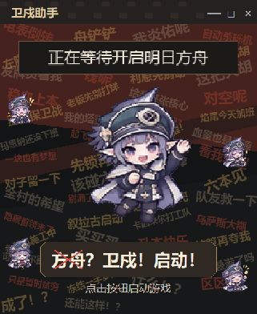

# 卫戍助手

**纯粹用爱发电，下载和使用都免费。** 有遇到的 bug、想加的小功能，或者你自己琢磨出来的打法，都可以来聊。欢迎改源码，也欢迎拿它做自己的免费工具。分享改版时留一下原项目和协议，注明改了什么就好。

原版、套壳版和基于这里改出来的成品都不能卖，也不能搞付费下载、收费解锁或者捆绑卖。对在中国大陆境内发生的、违反协议并侵害作者权益的行为，作者保留依法追究和起诉的权利。完整条款见[开发者协议](LICENSE.md)。

## 这款卫戍辅助软件能做什么？

这是给《明日方舟》PC 端「卫戍协议」做的小工具。它跟着游戏窗口，能看这把有哪些盟约、商店里哪些牌值得买、阵容从一本到六本怎么换。想查装备三连、敌人的机制，或者估一下这一波会漏几个怪，也能直接在游戏里看。

## 为什么会有这个软件？

卫戍一局要记的东西挺多。比如这把想玩一个流派，进了商店才发现核心所在的盟约被禁了。还有些装备平时见得少，买到了也想不起三连以后是干什么的。我就想把这些东西放在手边，省得每次都要切出去翻。

## 希望能帮到大家什么？

刚上手的时候，可以照着一图流知道每本先拿谁，核心没来就找张过渡。打熟了，可以拿它看看冷门搭配还有没有继续玩的机会。喜欢自己拿牌的，开着图鉴和敌情也行。

[下载助手](https://github.com/agtyin-code/arknights-weishu-assistant/releases) · [点击直接下载](https://github.com/agtyin-code/arknights-weishu-assistant/releases/download/v0.11.5-preview.1/WeishuAssistant-0.11.5-win-x64-setup.exe) · [安装和快捷键](#安装启动和快捷键) · [版本说明](RELEASE_NOTES.md)

**按功能找**

[卫戍内置图鉴](#卫戍内置图鉴) · [开局策略推荐](#开局策略推荐) · [本局详情与首领](#本局详情与首领) · [流派推荐](#流派推荐) · [1到6本运营一图流](#1到6本运营一图流)  
[商店拿牌提示](#商店拿牌提示) · [刷新冻结和升本](#刷新冻结和升本) · [地图站位建议](#地图站位建议) · [八人装备图](#八人装备图)  
[战前胜率和漏怪预测](#战前胜率和漏怪预测) · [悬赏推荐指数](#悬赏推荐指数) · [怪物图鉴与敌情](#怪物图鉴与敌情)

## 卫戍内置图鉴

点左上角的书，准备阶段和战斗中都能翻。里面有盟约、干员、装备和策略。盟约栏按当局可用项显示，干员和装备可以按 1 到 6 星筛，每页六张。选中一张卡就能切「普通 / 三连」，看效果具体变了什么。

## 开局策略推荐

第二页选策略时，会从这局出现的候选里给建议，结合地图和可用盟约看输出、生存和经济。头像旁边能直接读效果。想看看队友怎么选，点面板边上的「折叠」。

## 本局详情与首领

从「流派与拿牌」点「本局详情」，可以翻本局地图、可用与禁用盟约。常规首领、隐秘首领各有头像。隐秘首领如果只是候选，页面会和已经触发的分开写。

## 流派推荐

「自动推荐」会看场上、备战区、商店和敌人，来牌合适时可以建议转型。「手动选择」就沿着你选的那条路走。想自己摸索就选「我自己随心打」。打起来以后也能看下一轮的拿牌计划。

## 1到6本运营一图流

左边看当前这本要找谁，右边看完整阵容。头像旁标了核心、输出、叠层和补盟约，「打法步骤」里写什么时候升本、怎么叠层、核心没来先拿谁。可以按盟约和关键词找打法。右边窄条能单独收起一图流，点左边的 × 会把两边一起关掉。

## 商店拿牌提示

商店卡上方会标「必拿」「过渡」或盟约提示。「必拿」是眼下用得上、也买得起的关键牌。想知道某张牌怎么叠层，点它上面的提示。买了一张之后，助手会用剩下的钱重新算下一张。手头紧又容易掉血时，会看有没有便宜的牌可以顶一下，或者先换站位。

## 刷新冻结和升本

刷新旁边看的是花掉刷新费之后，刷到而且买得起至少一张目标牌的机会。钱不够买眼前的目标时，冻结会比较留牌和下回合换店的收益，也会算上准备升本时能多出的高阶牌机会。升本入口旁可以看花费和余额。

牌池会列观察到的持有数和参考容量。如果得先卖牌或用金币道具，建议从当前能做的那一步开始，钱到账后再算。「本局运营」里能查策略怎么起手、花多少、什么时候停。

## 地图站位建议

打开「站位 / 装备」，A 是现在的摆法，B 是建议摆法。看图就能找到干员该放哪、朝哪边，也能对照已读到的敌人走线。建议会参考地形、攻击范围、阻挡、对空和治疗。阵容打不到飞行怪，或者这轮有护盾、折射、元素损伤等麻烦，也会在推荐里提醒。

## 八人装备图

一排干员头像，下面直接看装备位。已装、手里有、店里有和缺失都标在装备图标上，鼠标放上去看效果。普通干员两格，森蚺策略下的暴躁铁皮（巨丑）普通四格、三连后六格。搭配会看盟约层数、装备和槽位，把叠同款、混搭、转盟约一起比较。

## 战前胜率和漏怪预测

游戏顶部两边显示还在场的玩家各自的**本轮零漏率**。它估的是这波能不能一个怪都不漏。比如「若漏 2 个」就是一旦漏怪，最可能漏 2 个。

准备阶段换阵会用本轮的阵容、站位和敌人重算，算完前保留上一笔本轮结果。打起来之后可以继续看。嫌数字碍眼就点「隐藏胜率」，下次打开还会记住。

## 悬赏推荐指数

悬赏三选或六选时，直接看游戏悬赏卡上方的 1～10 分，推演时这里会显示「计算中」。分数越高，当前阵容越有把握。推荐也会考虑悬赏奖励。想看加进来的怪是什么，点分数就能查。

## 怪物图鉴与敌情

游戏里按 `W` 打开敌情，左边选怪，右边看生命、攻击、防御和法抗。这里也收录了已整理的走线、阻挡、技能和特殊触发条件。游戏敌情收起后，跟着它打开的面板会一起收回。

## 安装启动和快捷键

用 **Windows x64** 的电脑，从发行页下安装包就行。想用便携版，把压缩包整个解开，再双击 `启动助手.cmd`。运行组件随包附带。

1. 打开卫戍助手，按 Windows 提示给这次启动授权。
2. 自己打开明日方舟，或者点助手里的「方舟？卫戍！启动！」。如果搜不到游戏，可以手动选官方启动器的位置。
3. 进入卫戍对局，面板会跟着游戏窗口。 `Ctrl+Shift+H` 隐藏或显示助手，`Ctrl+Shift+Q` 退出。

目前是 **0.11.5 预览版**。个别联机界面的卡牌位置和预测还会有偏差。更新时先关助手，再用新安装包覆盖安装，原来的本机设置和记录会保留。

## 感谢

谢谢 [SquadPool] 和 [PRTS Wiki] 整理资料，也谢谢愿意开局帮忙试功能的人。卫戍助手是玩家做的非官方工具。游戏名称、角色和美术归各自权利人，第三方资料和库沿用原有许可。

[SquadPool]: https://squad-pool.com/arknights-pacts
[PRTS Wiki]: https://prts.wiki/
