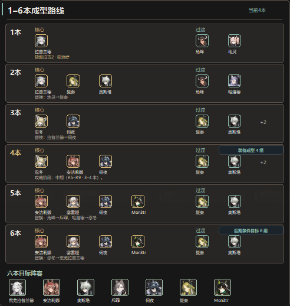

# 卫戍助手 0.11.5 预览版

**纯粹用爱发电，免费下载。** 欢迎提建议、修 bug，或者用源码做自己的免费工具。原版、套壳和改出来的成品都不能收费卖。对在中国大陆境内发生的、违反协议并侵害作者权益的行为，作者保留依法追究和起诉的权利。完整条款见[开发者协议](LICENSE.md)。

## 下载哪个文件

| 文件 | 怎么用 |
| --- | --- |
| `WeishuAssistant-0.11.5-win-x64-setup.exe` | 第一次用下这个。双击安装，再从开始菜单打开「卫戍助手」。 |
| `WeishuAssistant-0.11.5-win-x64-portable.zip` | 想用便携版就下这个。完整解压，双击 `启动助手.cmd`。 |
| `WeishuAssistant-0.11.5-source.zip` | 源码。想看推荐怎么算、想改东西就下这个。 |
| `LICENSE.md` | 开发者协议。 |
| `SHA256SUMS.txt` | 用来核对下载文件的 SHA-256。 |

适用于 **Windows x64** 和明日方舟 PC 客户端。打开助手后按 Windows 提示授权，然后开游戏进卫戍。更新前先退出助手，再运行新安装包。

## 进游戏后去哪找

- 忘了装备的三连效果，点左上角那本书。 [卫戍内置图鉴](README.md#卫戍内置图鉴)
- 不知道现在这本该买谁，看左边的「流派与拿牌」。 [商店拿牌提示](README.md#商店拿牌提示) · [1到6本运营一图流](README.md#1到6本运营一图流)
- 想查人怎么摆、谁缺装备，从「站位 / 装备」进去。 [地图站位建议](README.md#地图站位建议) · [八人装备图](README.md#八人装备图)
- 想看看这波能不能接住，读游戏顶部的零漏率，按 `W` 查怪。 [战前胜率和漏怪预测](README.md#战前胜率和漏怪预测) · [怪物图鉴与敌情](README.md#怪物图鉴与敌情)
- 三选、六选悬赏时，推荐分直接写在悬赏卡上方。 [悬赏推荐指数](README.md#悬赏推荐指数)

其他功能和截图见[项目首页](README.md)。
